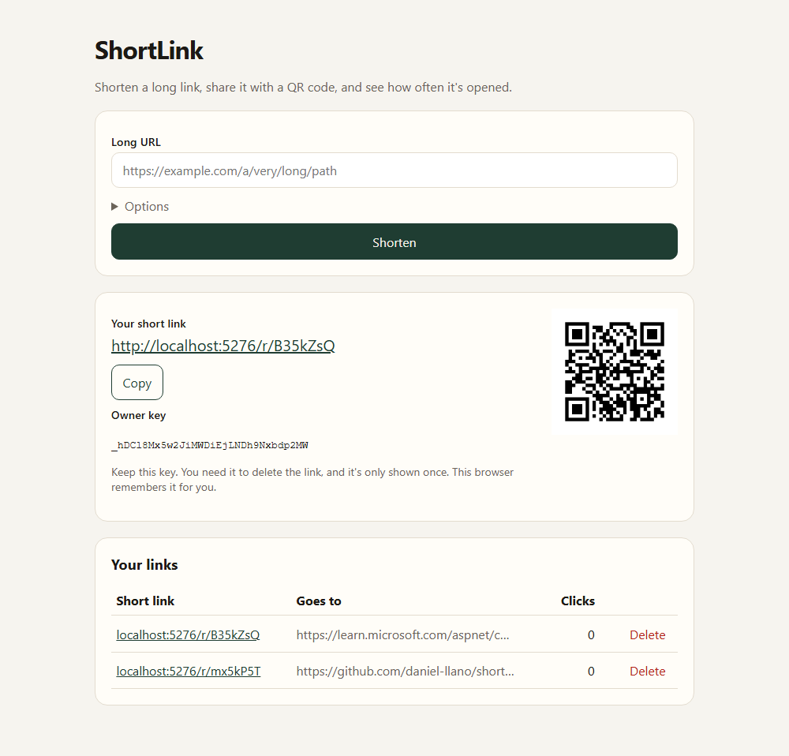

# ShortLink

URL shortener with QR codes, click counts, custom aliases, and expiring links. Ships with `Rle`, a small run-length encoding library.

License: Apache-2.0. Keep `LICENSE` and `NOTICE` if you fork it.
Author: Daniel Llano ([github.com/daniel-llano](https://github.com/daniel-llano))



## What it does

- `POST /api/links` turns a long https URL into `/r/{code}`. Codes are 7 random characters, or an alias you pick.
- Each redirect counts a click with a single atomic `UPDATE`, so concurrent clicks are never lost. The lookup itself is cached in Redis.
- Links can expire. An expired link answers 410 Gone.
- Creating a link returns an owner key once. Only its SHA-256 hash is stored, and deleting the link needs it in `X-Owner-Key`.
- `GET /api/links/{code}/qr` returns a PNG QR code.
- The home page remembers the links you made in this browser and shows their click counts.

Set `Api:Key` to require an `X-Api-Key` header for creating links, for a private deployment.

## Layout

```
shortlink/
├── src/ShortLink.Api   minimal API, EF Core (PostgreSQL), Redis cache, static UI in wwwroot
├── src/Rle             run-length encoding library
├── tests/              integration tests (SQLite) and library tests
├── infra/              docker-compose for PostgreSQL, Redis, and the app
└── e2e/                Playwright tests against the compose stack
```

## Run it

```bash
./scripts/run.sh        # or .\scripts\run.ps1
```

Open http://localhost:5276. The API reference is at http://localhost:5276/docs.

For quick local work, `dotnet run --project src/ShortLink.Api` uses SQLite and an in-memory cache from `appsettings.Development.json`.

## API

| Method | Path | Notes |
|--------|------|-------|
| POST | `/api/links` | `{ url, alias?, expiresAt? }`. Returns the short URL and the owner key |
| GET | `/api/links/{code}` | Target, click count, created, expires, last clicked |
| GET | `/api/links/{code}/qr` | PNG |
| DELETE | `/api/links/{code}` | Needs `X-Owner-Key` |
| GET | `/r/{code}` | 302 to the target, 404 unknown, 410 expired |
| GET | `/health/live`, `/health/ready` | |

## Configuration

| Key | Notes |
|-----|-------|
| `ConnectionStrings:ShortLink` | PostgreSQL connection string |
| `Database:Provider` | `Postgres` (default) or `Sqlite` for a single box |
| `Database:MigrateOnStartup` | Off by default. Run `dotnet ef database update` from your pipeline |
| `ConnectionStrings:Redis` | Optional. Without it the cache is in memory, per instance |
| `Links:PublicBaseUrl` | Public origin for short URLs and QR codes, like `https://sho.rt` |
| `Links:AllowHttpTargets` | Off by default, so only https targets are accepted |
| `Api:Key` | Optional key required to create links |
| `RateLimiting:CreatesPerMinute` | Per IP, default 30 |

## Rle

```csharp
RunLength.Encode("aaabcc");   // "3a1b2c"
RunLength.Decode("3a1b2c");   // "aaabcc"
```

Counts are written as digits, so `Encode` rejects input that contains digits and `Decode` rejects malformed input instead of guessing.

## Tests

```bash
./scripts/test.sh   # library tests + API integration tests on a temp SQLite file
./scripts/e2e.sh    # Docker stack + Playwright
```

See [TESTING.md](TESTING.md).
